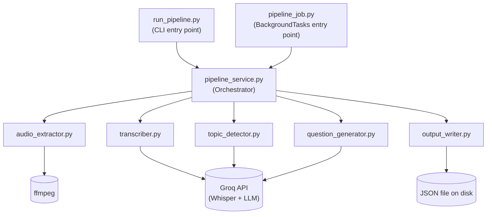

# Design Document: Adaptive Learning Platform — AI Pipeline Module

## Overview

The AI pipeline is a standalone Python module that transforms a raw video file into structured learning content. It runs in `backend/app/services` and `backend/app/jobs`, and can be driven either by the `backend/run_pipeline.py` CLI or by FastAPI's `BackgroundTasks` when triggered by an upload endpoint.

The pipeline executes five sequential stages:

1. **Audio extraction** — ffmpeg strips the audio track to a temporary WAV file.
2. **Transcription** — the Groq Whisper API converts the WAV to a timestamped, word-level transcript.
3. **Topic detection** — a Groq LLM identifies exactly four topics from the transcript and returns structured JSON; each topic's end time is then snapped to the nearest Whisper segment boundary.
4. **Question generation** — a Groq LLM generates four multiple-choice questions per topic, using only that topic's transcript slice.
5. **Output persistence** — the complete result (four topics, sixteen questions) is written as JSON to disk.

All secrets are read from environment variables loaded via python-dotenv from `backend/.env`. No credentials appear in source code.

---

## Architecture



The orchestrator (`pipeline_service.py`) owns the top-level control flow. Each stage module is a pure Python function with no cross-stage imports, making each stage independently testable. Error propagation uses Python exceptions; the orchestrator catches them and decides whether to surface to the CLI or the background-job caller.

---

## Components and Interfaces

### File Layout

```
backend/
├── run_pipeline.py              # CLI entry point
├── requirements.txt
├── .env
├── .env.example
└── app/
    ├── services/
    │   ├── audio_extractor.py   # Stage 1: ffmpeg wrapper
    │   ├── transcriber.py       # Stage 2: Groq Whisper
    │   ├── topic_detector.py    # Stage 3: LLM topic detection + snapping
    │   ├── question_generator.py# Stage 4: LLM question generation
    │   ├── output_writer.py     # Stage 5: JSON persistence
    │   └── pipeline_service.py  # Orchestrator
    ├── jobs/
    │   └── pipeline_job.py      # FastAPI BackgroundTask wrapper
    └── tests/
        ├── test_snapping.py
        ├── test_topic_validation.py
        └── test_question_validation.py
```

### Component Interfaces

#### `audio_extractor.py`

```python
def extract_audio(video_path: str) -> str:
    """
    Extracts the audio track from video_path to a temporary WAV file.
    Returns the path to the temp WAV file on success.
    Raises AudioExtractionError on ffmpeg failure or zero-duration output.
    The caller is responsible for deleting the returned file.
    """
```

#### `transcriber.py`

```python
def transcribe(wav_path: str) -> TranscriptResult:
    """
    Calls the Groq Whisper API and returns a TranscriptResult.
    Retries up to 3 times with exponential back-off (1s, 2s, 4s).
    Raises TranscriptionError on API failure or zero-segment response.
    """
```

#### `topic_detector.py`

```python
def detect_topics(transcript: TranscriptResult) -> list[Topic]:
    """
    Sends the full transcript to the Groq LLM and returns exactly 4 Topics.
    Validates JSON response; retries up to 3 times on validation failure.
    Snaps each topic's end time to the nearest segment boundary.
    Raises TopicDetectionError on persistent failure or post-snap ordering violation.
    """

def snap_end_time(raw_end: float, segments: list[Segment]) -> float:
    """
    Returns the segment end time nearest to raw_end.
    On a tie, returns the later segment's end time.
    Pure function; no side effects.
    """

def validate_topics(data: Any) -> bool:
    """
    Returns True iff data is a list of exactly 4 topic objects in
    chronological, non-overlapping order with valid field types and lengths.
    Returns False (never raises) for any malformed input.
    """
```

#### `question_generator.py`

```python
def generate_questions(topic: Topic, transcript_slice: str) -> list[Question]:
    """
    Sends transcript_slice to the Groq LLM and returns exactly 4 Questions.
    Uses a 30-second timeout. Validates response; retries up to 3 times.
    Raises QuestionGenerationError on persistent failure.
    """

def validate_questions(data: Any) -> bool:
    """
    Returns True iff data is a list of exactly 4 question objects, each with
    all required fields and correct_index in [0, 3].
    Returns False (never raises) for any malformed input.
    """
```

#### `output_writer.py`

```python
def write_output(result: PipelineOutput, output_path: str) -> None:
    """
    Serialises result to JSON and writes it to output_path.
    Raises OutputWriteError on any I/O failure.
    """
```

#### `pipeline_service.py`

```python
def run_pipeline(video_path: str, output_path: str) -> PipelineOutput:
    """
    Orchestrates all five stages in sequence.
    Handles temp-file cleanup in a finally block regardless of success or failure.
    Raises PipelineError (wrapping stage-specific exceptions) on failure.
    """
```

#### `pipeline_job.py`

```python
def enqueue_pipeline(video_path: str, output_path: str) -> None:
    """
    Entry point called by FastAPI BackgroundTasks.
    Calls run_pipeline and updates any database record for the video on completion or failure.
    """
```

---

## Data Models

All intermediate structures are Python dataclasses (or TypedDicts for JSON interchange). The same shapes are used for in-memory passing and for the final JSON output.

### `Segment` (Whisper output, intermediate)

```python
@dataclass
class WordEntry:
    word: str
    start: float   # seconds
    end: float     # seconds

@dataclass
class Segment:
    start: float         # seconds
    end: float           # seconds
    text: str
    words: list[WordEntry]
```

### `TranscriptResult` (Transcriber output, intermediate)

```python
@dataclass
class TranscriptResult:
    segments: list[Segment]   # len >= 1
```

### `Topic` (Topic Detector output)

```python
@dataclass
class Topic:
    keyword: str    # 1–60 characters
    start: float    # seconds
    end: float      # seconds, snapped to nearest segment boundary
```

### `Question` (Question Generator output)

```python
@dataclass
class Question:
    prompt: str
    options: list[str]   # exactly 4 elements
    correct_index: int   # 0–3 inclusive
    explanation: str
```

### `TopicWithQuestions` (combined, per topic)

```python
@dataclass
class TopicWithQuestions:
    keyword: str
    start: float
    end: float
    questions: list[Question]  # exactly 4
```

### `PipelineOutput` (final JSON written to disk)

```python
@dataclass
class PipelineOutput:
    video_path: str
    topics: list[TopicWithQuestions]  # exactly 4, in chronological order
```

**Example final JSON shape:**

```json
{
  "video_path": "uploads/lecture_01.mp4",
  "topics": [
    {
      "keyword": "Introduction to Photosynthesis",
      "start": 0.0,
      "end": 182.44,
      "questions": [
        {
          "prompt": "What is the primary input for photosynthesis?",
          "options": ["Oxygen", "Carbon dioxide", "Nitrogen", "Hydrogen"],
          "correct_index": 1,
          "explanation": "Plants use CO₂ from the air as the main carbon source."
        }
      ]
    }
  ]
}
```

### End-Time Snapping Algorithm

The snapping function aligns each LLM-returned topic `end` time to a real Whisper segment boundary to prevent video pauses mid-sentence.

**Algorithm:**

```
function snap_end_time(raw_end, segments):
    best = None
    best_distance = +∞
    for each segment in segments:
        distance = |segment.end - raw_end|
        if distance < best_distance:
            best = segment.end
            best_distance = distance
        elif distance == best_distance:
            # Tie: prefer the later segment end time
            best = max(best, segment.end)
    return best
```

**Properties:**
- **Deterministic**: same inputs always produce the same output.
- **Idempotent**: applying the function twice returns the same value as applying it once, because the second call's input (`segment.end`) is already a member of the segments list.
- **Tie-breaking**: on equal distance, the later boundary is selected to avoid cutting off a sentence that extends slightly past the LLM's estimate.

**Post-snap validation**: after all four end times are snapped, the pipeline verifies that the resulting end times are strictly ascending (no duplicates, no reordering). If this check fails, the pipeline prints to stderr and stops.

---

## Correctness Properties

*A property is a characteristic or behavior that should hold true across all valid executions of a system — essentially, a formal statement about what the system should do. Properties serve as the bridge between human-readable specifications and machine-verifiable correctness guarantees.*

### Property 1: Snap idempotence

*For any* list of Whisper segments and any raw end time, applying `snap_end_time` twice SHALL produce a result identical to applying it once — the second application returns the same float as the first.

**Validates: Requirements 6.6**

### Property 2: Snap selects a valid segment end

*For any* non-empty list of Whisper segments and any raw end time, `snap_end_time` SHALL return a value that is a member of the set of segment end times in that list.

**Validates: Requirements 3.5**

### Property 3: Snap minimises distance

*For any* non-empty list of Whisper segments and any raw end time, the absolute difference between `raw_end` and the value returned by `snap_end_time` SHALL be less than or equal to the absolute difference between `raw_end` and any other segment end time in the list.

**Validates: Requirements 3.5**

### Property 4: Snap tie-breaking selects the later time

*For any* list of segments containing two or more entries equidistant from `raw_end`, `snap_end_time` SHALL return the largest (latest) of those equidistant segment end times.

**Validates: Requirements 3.5**

### Property 5: Topic validation rejects structurally invalid inputs

*For any* topic list that is missing a required field, contains overlapping time ranges, contains non-chronological ordering, or has a count other than four, `validate_topics` SHALL return `False` and SHALL NOT raise any exception.

**Validates: Requirements 3.2, 3.3**

### Property 6: Question validation rejects out-of-range correct_index

*For any* question object where `correct_index` is an integer outside the range [0, 3], `validate_questions` SHALL return `False` and SHALL NOT raise any exception.

**Validates: Requirements 4.2, 4.3**

### Property 7: Question validation rejects missing fields

*For any* question object missing any of `prompt`, `options`, `correct_index`, or `explanation`, `validate_questions` SHALL return `False` and SHALL NOT raise any exception.

**Validates: Requirements 4.2, 4.3**

### Property 8: Pipeline output round-trip serialisation

*For any* valid `PipelineOutput`, serialising it to JSON and then deserialising the resulting string SHALL produce a value equivalent to the original, with all numeric fields within floating-point precision.

**Validates: Requirements 4.5**

---

## Error Handling

### Error Taxonomy

| Exception class | Raised by | Condition |
|---|---|---|
| `AudioExtractionError` | `audio_extractor` | ffmpeg non-zero exit or zero-duration WAV |
| `TranscriptionError` | `transcriber` | Groq API error after 3 retries, or zero segments |
| `TopicDetectionError` | `topic_detector` | JSON validation fails after 3 retries, or post-snap ordering violation |
| `QuestionGenerationError` | `question_generator` | Validation fails after 3 retries, or 30s timeout exhausted |
| `OutputWriteError` | `output_writer` | Any I/O error writing the output file |
| `ConfigurationError` | `pipeline_service` | `GROQ_API_KEY` absent or empty at startup |

All exceptions inherit from a common `PipelineError` base class. The orchestrator and CLI catch `PipelineError`, print the message to stderr, and exit with a non-zero code.

### Retry Strategy

The same exponential back-off wrapper is shared by both the Whisper API and both LLM calls:

```
attempt 1 — immediate
attempt 2 — wait 1 s
attempt 3 — wait 2 s
(total: 3 attempts; maximum additional wait: 3 s)
```

For the Whisper API (Requirement 2.2), retries are on network or API errors. For LLM calls (Requirements 3.3, 4.3), retries fire on JSON validation failures as well as network or API errors. Each retry discards the previous partial result before making a new request.

### Temporary File Cleanup

`pipeline_service.run_pipeline` creates the temp WAV path before the first stage and wraps all stage calls in a `try/finally` block:

```python
wav_path = None
try:
    wav_path = extract_audio(video_path)
    # … remaining stages …
finally:
    if wav_path and os.path.exists(wav_path):
        os.remove(wav_path)
```

This guarantees cleanup even when an exception propagates from any stage.

### Environment Validation

Before any pipeline work starts, `pipeline_service` loads `.env` via python-dotenv and checks that `GROQ_API_KEY` is present and non-empty. If the check fails, it raises `ConfigurationError` immediately, printing the missing variable name to stderr without making any API calls.

---

## Testing Strategy

### Unit Tests

Unit tests live in `backend/app/tests/` and cover pure functions that contain the core logic. The goal is targeted coverage of the snapping algorithm and both validation functions; property-based tests handle broad input coverage.

**`test_snapping.py`** — covers `snap_end_time`:

| Case | Description |
|---|---|
| Single segment | Returns the only segment's end time regardless of raw_end |
| Exact match | raw_end equals a segment end — returns that value |
| Nearest is earlier | raw_end is closer to an earlier segment |
| Nearest is later | raw_end is closer to a later segment |
| Tie-breaking | Two segments equidistant from raw_end — returns the later one |
| All equidistant | Multiple segments all equidistant — returns the latest |

**`test_topic_validation.py`** — covers `validate_topics`:

| Case | Description |
|---|---|
| Valid input | 4 topics, ordered, non-overlapping — returns True |
| Missing `keyword` | Returns False, no exception |
| Missing `start` or `end` | Returns False, no exception |
| Overlapping ranges | Returns False, no exception |
| Non-chronological order | Returns False, no exception |
| Fewer than 4 topics | Returns False, no exception |
| More than 4 topics | Returns False, no exception |
| keyword exceeds 60 chars | Returns False, no exception |
| Non-numeric start/end | Returns False, no exception |

**`test_question_validation.py`** — covers `validate_questions`:

| Case | Description |
|---|---|
| Valid input | 4 questions, all fields present, correct_index in [0,3] — returns True |
| Missing `prompt` | Returns False, no exception |
| Missing `options` | Returns False, no exception |
| Missing `correct_index` | Returns False, no exception |
| Missing `explanation` | Returns False, no exception |
| `options` has 3 elements | Returns False, no exception |
| `options` has 5 elements | Returns False, no exception |
| `correct_index` = -1 | Returns False, no exception |
| `correct_index` = 4 | Returns False, no exception |
| Fewer than 4 questions | Returns False, no exception |
| More than 4 questions | Returns False, no exception |

### Property-Based Tests

Property-based tests use **[Hypothesis](https://hypothesis.readthedocs.io/)**, a mature Python PBT library. Each test runs a minimum of 100 iterations (configured via `@settings(max_examples=100)`).

Each test is tagged with a comment in the following format:
`# Feature: adaptive-learning-platform, Property N: <property_text>`

**Property 1 — Snap idempotence**
Generate a random list of segments (1–20 entries, end times as positive floats) and a random `raw_end`. Assert `snap(snap(raw_end, segs), segs) == snap(raw_end, segs)`.

**Property 2 — Snap selects a valid segment end**
Same generators. Assert the return value is in `{s.end for s in segments}`.

**Property 3 — Snap minimises distance**
Same generators. Assert `|result - raw_end| <= |seg.end - raw_end|` for every segment in the list.

**Property 4 — Snap tie-breaking**
Generate a list where at least two segments are equidistant from `raw_end`. Assert the returned value equals `max(equidistant_ends)`.

**Property 5 — Topic validation rejects structurally invalid inputs**
Generate randomly malformed topic lists (wrong count, missing fields, bad types, overlapping ranges). Assert `validate_topics(data) is False` and no exception is raised.

**Property 6 — Question validation rejects out-of-range correct_index**
Generate question objects with `correct_index` drawn from integers outside [0, 3]. Assert `validate_questions([q]) is False` and no exception is raised.

**Property 7 — Question validation rejects missing fields**
Generate question objects with one required field removed at random. Assert `validate_questions([q]) is False` and no exception is raised.

**Property 8 — Pipeline output round-trip serialisation**
Generate valid `PipelineOutput` instances. Serialise to JSON string, deserialise back. Assert all fields are equal (floats compared within `1e-9` tolerance).

### Integration Notes

The pipeline stages that call external services (Groq API, ffmpeg) are tested via integration tests that run only when real credentials and binaries are available (skipped in CI by default). Integration tests use 1–2 representative video examples rather than property generation, since the behaviour of external services does not vary in a property-testable way.
